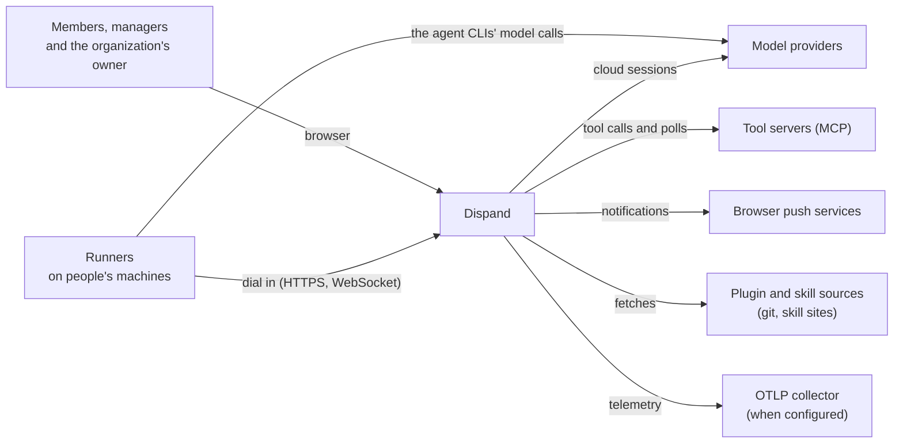
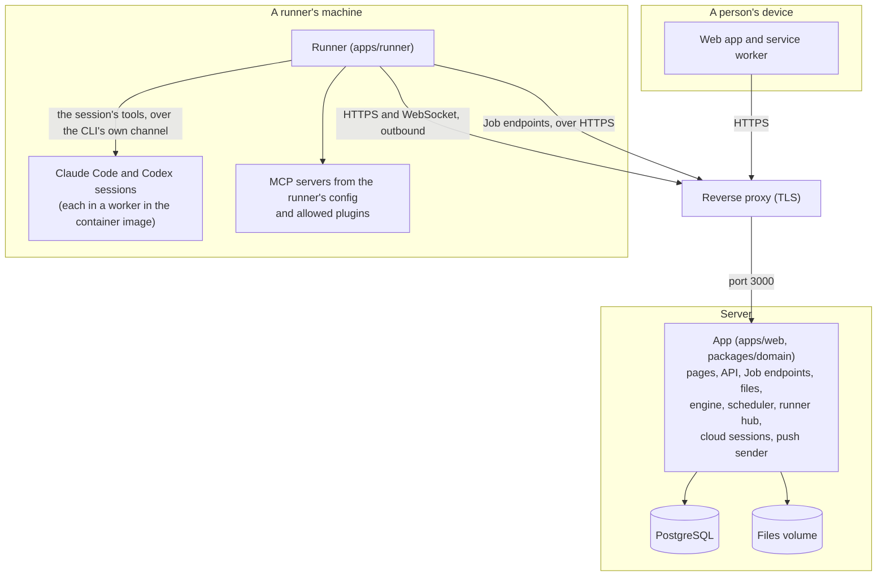
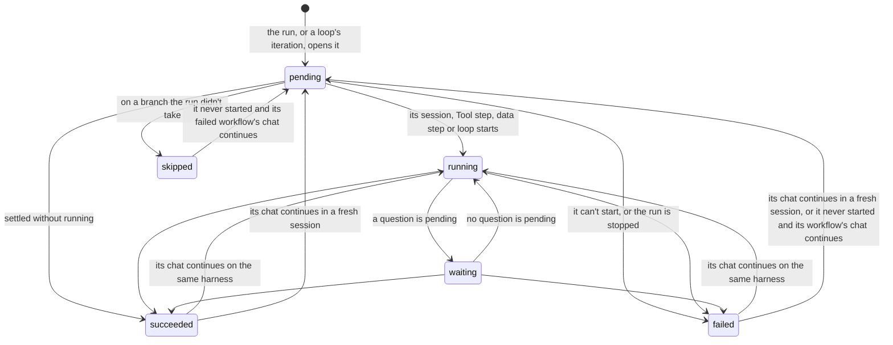
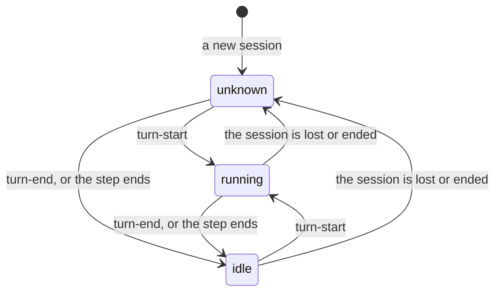
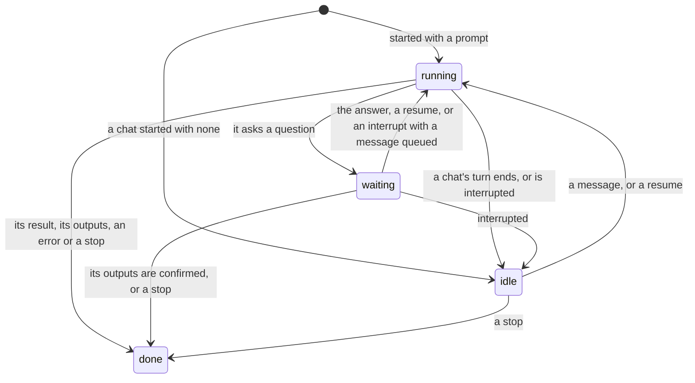
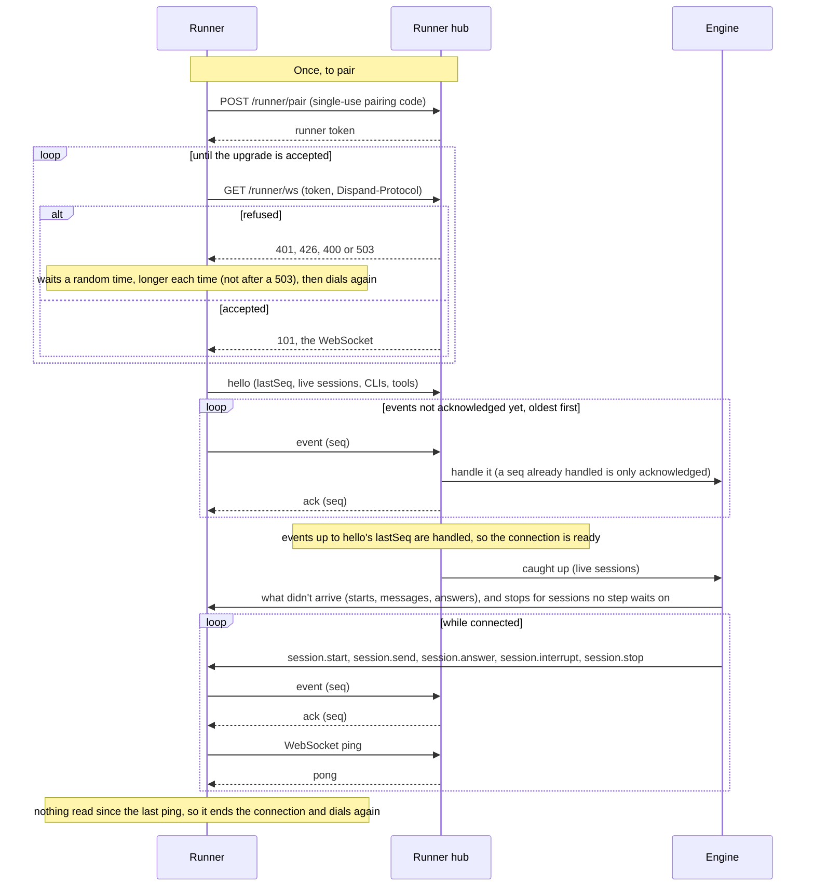

# Diagrams

The stable views: what Dispand talks to, what it is made of, the states a step and its session go
through, and how a runner connects. The files beside this one hold the rules behind them.

## Context

## Containers

The reference deployment (`deploy/compose.yaml`) is the app and PostgreSQL behind your reverse
proxy. A development or test server may use PGlite in place of PostgreSQL.

In the container image the supervisor, not the worker, holds the Job endpoints' address and token
and connects to every MCP server the session gets (`docs/security/sessions.md`). On the bare install
the CLI reaches the Job endpoints itself, and starts the runner's MCP servers through the runner's proxy.

## States

A run's node is a `step_runs` row. Its status, its session's turn and, for a cloud harness, the
session itself each have their own states. `db/state-diagrams.test.ts` in `packages/domain` fails
when a diagram below names a state its type in `db/schema.ts` doesn't have, or misses one.

### Step status (`StepStatus`)

### Turn status (`TurnStatus`)

What an interactive session last reported of its turn, apart from the step's status and from
whether it holds a harness slot.

### Cloud session status (`CloudSessionStatus`)

Dispand runs a cloud session's tool loop itself (`cloud/runner.ts`).

## A runner's connection

The upgrade is refused with 401 for an unknown or revoked token, 426 for a runner older than the
server, 400 for any other protocol version, and 503 while the server takes no connection for that
runner.
